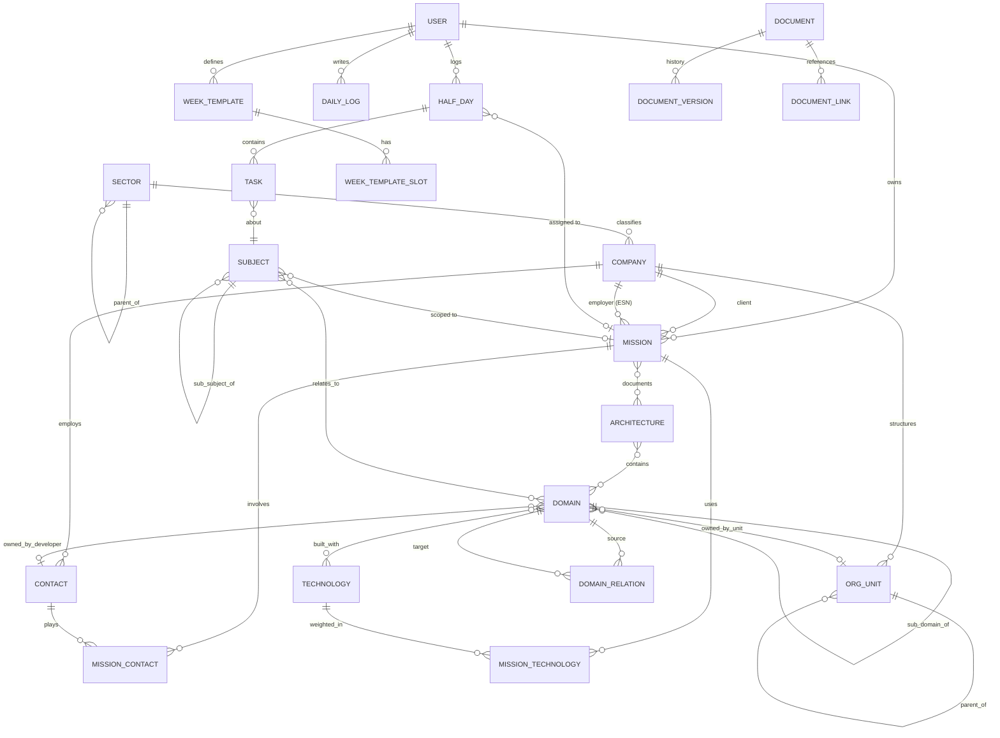
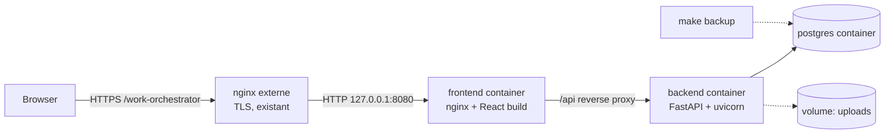

# Work Orchestrator — Document de cadrage

> Version 0.1 — 2026-11-05 — statut : **brouillon** — décisions actées le 2026-11-05 : PostgreSQL, Mantine, TypeScript, usage solo en modèle multi-utilisateur, mission = client + ESN. Questions closes le 2026-11-05 ([01-QUESTIONS.md](01-QUESTIONS.md)). **Toutes les décisions structurantes sont dans [adr/](adr/README.md)** ; en cas de divergence, l'ADR fait foi.
>
> Les points marqués **[H-xx]** sont des hypothèses prises par défaut. Ils correspondent à une question du fichier de questions et peuvent être remis en cause.

---

## 1. Contexte

Développeur consultant, l'utilisateur enchaîne plusieurs missions chez différents clients, avec des périodes d'inter-contrat, de formation et de congés. La connaissance acquise (architecture, contacts, technologies, décisions) est aujourd'hui dispersée et se perd d'une mission à l'autre.

## 2. Objectifs

| # | Objectif | Indicateur de réussite |
|---|----------|------------------------|
| O1 | Historiser chaque demi-journée travaillée (nature + sujets traités) | Saisie quotidienne en moins de 2 minutes |
| O2 | Visualiser son activité en vue macro (année, mois) et micro (semaine, jour) | Passage macro vers micro en 1 clic |
| O3 | Documenter les architectures techniques des missions en Markdown, sous forme de graphe | Export Mermaid et Markdown copiable en 1 clic |
| O4 | Avoir une vue « 360° » d'une mission : tâches, technos pondérées, contacts, docs, temps passé | Une page unique par mission |
| O5 | Garder un annuaire de contacts unique pour toute l'application | Aucun contact dupliqué entre missions |
| O6 | Tout relier : de l'agenda on rejoint la doc de la mission, et inversement | Navigation bidirectionnelle |

## 3. Périmètre

### 3.1 Dans le périmètre (V1)

- **Socle** : authentification maison, i18n EN/FR, thème, recherche globale.
- **Référentiels partagés** : secteurs d'activité, entreprises (clients, ESN, intermédiaires), contacts, technologies, tags.
- **Missions** : CRUD, cycle de vie, rattachement client, vue tableau de bord.
- **Sous-app Agenda (« Subject Agenda »)** : demi-journées, semaines types, journal quotidien (« hier / aujourd'hui »), tâches, sujets et sous-sujets, vues macro et micro.
- **Sous-app Architecture (« Architecture Representation »)** : architectures techniques, domaines (hiérarchie et relations), organisation client (direction, pôle, équipe), documents Markdown, vue graphe, export Mermaid.
- **Exploitation** : Docker Compose, Makefile, sauvegarde et restauration, tests automatisés.

### 3.2 Hors périmètre (V1)

- 2FA, SSO, OAuth.
- Hébergement cloud, haute disponibilité.
- Collaboration temps réel (édition simultanée).
- Application mobile native (le web responsive suffit).
- Synchronisation avec les outils du client (Confluence, Jira…). On se limite à l'export par copier-coller du Markdown.

### 3.3 Pistes post-V1 (voir roadmap, phase 13)

Export CRA (compte rendu d'activité), statistiques, import ICS, décisions d'architecture (ADR), glossaire, compétences et génération de CV, intégration LLM.

## 4. Utilisateurs

- **[décidé]** Un seul utilisateur réel, mais modèle **multi-utilisateur** dès le départ : chaque donnée personnelle porte un `owner_id`. Coût faible maintenant, migration lourde plus tard.
- Rôles : `admin` (gestion des comptes) et `user`.

## 5. Modèle de domaine

### 5.1 Glossaire

| Terme (FR) | Entité (code) | Définition |
|------------|---------------|------------|
| Secteur d'activité | `Sector` | Banque, assurance, retail… Hiérarchique **[H-10]** |
| Entreprise | `Company` | Personne morale : client ou ESN employeuse |
| Mission | `Mission` | Engagement de l'utilisateur chez un client, sur une période, avec un intitulé de poste |
| Contact | `Contact` | Personne de l'annuaire global, rattachée éventuellement à une entreprise |
| Rôle du contact en mission | `MissionContact` | Lien contact ↔ mission avec un rôle (manager, PO, tech lead…) |
| Unité organisationnelle | `OrgUnit` | Direction, pôle ou équipe d'une entreprise (arbre) |
| Demi-journée | `HalfDay` | Créneau matin ou après-midi d'une date, avec une nature (mission, inter-contrat…) |
| Nature de demi-journée | `HalfDayKind` | MISSION, INTERCONTRACT, TRAINING, LEAVE, PUBLIC_HOLIDAY, SICK_LEAVE, OFF… |
| Semaine type | `WeekTemplate` | Modèle de 10 à 14 créneaux applicable sur une période |
| Verrou mensuel | `MonthLock` | Validation d'un mois façon CRA : plus aucune modification du temps saisi tant qu'il n'est pas déverrouillé (ADR-0021) |
| Journal quotidien | `DailyLog` | Note du jour : « hier j'ai fait… / aujourd'hui je compte faire… » |
| Sujet | `Subject` | Thème de travail hiérarchique (sujet, sous-sujet…), rattaché à une mission ou à l'inter-contrat |
| Tâche | `Task` | Travail daté (début, durée) sur un sujet, dans une demi-journée |
| Architecture technique | `Architecture` | Cartographie d'un système, rattachée à une ou plusieurs missions |
| Domaine | `Domain` | Brique fonctionnelle ou technique. Arbre (sous-domaines) et graphe (relations) |
| Relation de domaines | `DomainRelation` | Lien orienté et typé entre deux domaines (appelle, dépend de, publie vers…) |
| Technologie | `Technology` | Langage, framework, base de données, outil… |
| Pondération techno | `MissionTechnology` | Degré d'implication d'une techno dans une mission (1 à 5) **[H-30]** |
| Document | `Document` | Page Markdown, versionnée, rattachable à une mission, une architecture, un domaine ou un sujet |
| Lien documentaire | `DocumentLink` | Lien `[[wikilink]]` d'un document vers une entité, à la base des rétroliens et du graphe |
| Tag | `Tag` | Étiquette libre transverse |

### 5.2 Diagramme entité-relation (cible V1)



### 5.3 Attributs principaux

**Mission**
`title` (nom interne), `job_title` (intitulé de poste), `client_id`, `employer_company_id` (votre ESN, pré-rempli depuis le paramètre utilisateur et figé sur la mission pour garder l'historique en cas de changement d'employeur) **[décidé]**, `start_date`, `planned_end_date`, `actual_end_date`, `status` (PROSPECT, ACTIVE, ON_HOLD, ENDED), `location`, `remote_policy`, `description` (Markdown), `color` (pour l'agenda), `daily_rate` (optionnel, chiffré à part) **[H-12]**.

**HalfDay**
`owner_id`, `date`, `period` (AM, PM), `kind`, `mission_id` (obligatoire si `kind = MISSION`, interdit sinon), `location` (CLIENT_ON_SITE, REMOTE_ESN_OFFICE, REMOTE_HOME, REMOTE_OTHER, TRAVEL_MISSION, TRAVEL_ESN — ADR-0019), `note`.
Unicité : (`owner_id`, `date`, `period`).

**Task**
`half_day_id`, `subject_id`, `title`, `starts_at` (heure), `duration_minutes`, `status` (PLANNED, DONE, CANCELLED, CARRIED_OVER), `description` (Markdown), `external_ref` (ticket Jira…).

**Subject**
`parent_id`, `mission_id` (nullable : null signifie sujet d'inter-contrat ou personnel), `scope` (MISSION, INTERCONTRACT, TRAINING, PERSONAL), `title`, `status`, `description`.

**Domain**
`parent_id` (sous-domaine), `name`, `kind` (BUSINESS, APPLICATION, INFRASTRUCTURE, DATA… **[H-20]**), `description` (Markdown), `owner_org_unit_id`, `owner_contact_id`, `criticality`.

**DomainRelation**
`source_id`, `target_id`, `type` (CALLS, DEPENDS_ON, PUBLISHES_TO, SUBSCRIBES_TO, READS_FROM, WRITES_TO, CUSTOM), `label`, `protocol` (REST, gRPC, Kafka…).

### 5.4 Règles métier

| Code | Règle |
|------|-------|
| RG-01 | Une demi-journée est unique par utilisateur, date et période. |
| RG-02 | `kind = MISSION` exige `mission_id`, et la date doit être dans la période de la mission. |
| RG-03 | Une tâche d'un sujet de portée INTERCONTRACT ne peut pas être placée dans une demi-journée MISSION (exigence explicite). |
| RG-04 | Réciproque : une tâche d'un sujet de mission ne peut être placée que dans une demi-journée MISSION de **la même** mission **[H-02]**. |
| RG-05 | Les demi-journées LEAVE, PUBLIC_HOLIDAY, SICK_LEAVE et OFF ne contiennent pas de tâches **[H-03]**. |
| RG-06 | La somme des durées des tâches d'une demi-journée peut dépasser 4 h, mais l'interface affiche un avertissement **[H-04]**. |
| RG-07 | Un sous-sujet hérite de la portée et de la mission de son parent. |
| RG-08 | L'arbre des domaines et celui des sujets sont acycliques. Un domaine ne peut pas être son propre ancêtre. |
| RG-09 | Une relation de domaine ne peut pas relier un domaine à lui-même. |
| RG-10 | Appliquer une semaine type n'écrase pas les demi-journées déjà saisies, sauf si l'utilisateur le demande explicitement (prévisualisation, puis confirmation). |
| RG-11 | Les jours fériés français (région choisie dans le profil) sont pré-remplis automatiquement, une seule fois par an, sur les demi-journées vides (ADR-0033). |
| RG-12 | Supprimer une mission référencée par des demi-journées est refusé : on archive la mission. |
| RG-13 | Un mois validé (verrouillé) refuse toute modification de demi-journée ou de tâche ; le valider exige que tous les jours ouvrés soient saisis ; le déverrouiller exige un motif, historisé (ADR-0021). |
| RG-14 | Mot de passe : 12 caractères minimum, au moins une majuscule, une minuscule, un chiffre et un symbole quelconque, sans jamais imposer un caractère à touche morte comme `^` (ADR-0008). |

## 6. Fonctionnalités

### 6.1 Socle

- Inscription contrôlée (création par l'admin ou premier compte créé via `make init`), connexion, déconnexion, changement de mot de passe, réinitialisation par l'admin.
- Sélecteur de langue EN/FR persistant (préférence utilisateur), thème clair ou sombre.
- Recherche globale (`Ctrl+K`) sur missions, contacts, documents, domaines, sujets et tâches.
- Fil d'Ariane et liens croisés partout.

### 6.2 Sous-app Agenda

| Vue | Contenu |
|-----|---------|
| **Année** (macro) | Grille de 365 jours × 2 demi-journées, couleur par nature et par mission, légende, totaux (jours mission, inter-contrat, congés…) |
| **Mois** | Calendrier mensuel, chaque case coupée en matin et après-midi, sélection multiple et affectation en masse |
| **Semaine** (micro) | 5 ou 7 colonnes × 2 demi-journées, tâches visibles, glisser-déposer |
| **Jour** (micro) | Journal « hier / aujourd'hui », tâches avec horaires, sujets, liens vers la doc de la mission |

- **Saisie quotidienne rapide** : écran « Standup » qui affiche les tâches prévues hier et permet de les marquer faites, reportées ou annulées, puis de planifier aujourd'hui.
- **Semaines types** : création, édition, duplication ; application sur une plage de dates avec prévisualisation des conflits.
- **Sélection et affectation en masse** (ex. : poser 2 semaines de congés).
- **Validation mensuelle façon CRA** : récapitulatif du mois, verrouillage, déverrouillage motivé (RG-13).
- Depuis toute demi-journée MISSION : lien direct vers le tableau de bord de la mission et sa documentation.

### 6.3 Sous-app Architecture

- **Architectures** : liste par mission, description, domaines contenus.
- **Domaines** : arbre (sous-domaines à profondeur illimitée) et relations typées.
- **Vue graphe interactive** : nœuds = domaines, arêtes = relations et inclusion ; filtres par architecture, type de domaine, équipe responsable, profondeur ; zoom ; regroupement des sous-domaines.
- **Export Mermaid** : `flowchart` (domaines et relations, sous-domaines en `subgraph`), à copier ou télécharger. Un `erDiagram` ou un `C4` sont envisageables plus tard.
- **Documents Markdown** : éditeur avec aperçu, blocs ```` ```mermaid ```` rendus en direct, `[[wikilinks]]` vers toute entité, rétroliens, historique des versions, bouton « Copier en Markdown » (liens internes convertis en texte).
- **Organisation client** : arbre direction > pôle > équipe, contacts rattachés, responsable de chaque domaine.

### 6.4 Tableau de bord mission (point de jonction des deux sous-apps)

- En-tête : client, ESN, intitulé de poste, dates, statut.
- **Temps passé** : jours (et demi-journées) en mission, répartition par sujet (calculée à partir des tâches).
- **Tâches** : récentes, en cours, prévues.
- **Technologies** : liste pondérée (barres ou nuage), pondération manuelle, avec suggestion calculée depuis les domaines **[H-31]**.
- **Contacts** : annuaire filtré sur la mission, avec leur rôle.
- **Architectures et documents** : accès direct, graphe miniature.

## 7. Architecture technique

### 7.1 Vue d'ensemble



### 7.2 Choix techniques

| Couche | Choix | Justification |
|--------|-------|---------------|
| Base de données | **PostgreSQL 17** **[décidé]** | CTE récursives (arbres, graphes), recherche plein texte, JSONB, robustesse |
| Back-end | FastAPI, SQLAlchemy 2.x (async, `asyncpg`), Alembic, Pydantic v2, `pydantic-settings` | Imposé |
| Gestion des paquets Python | `uv` + `pyproject.toml` | Imposé |
| Authentification | Mots de passe hachés en **Argon2id** (`argon2-cffi`), JWT d'accès court (15 min) et refresh token en base (rotation), dans des cookies `httpOnly` `SameSite=Strict` | Maison, sans 2FA, révocable |
| Protection | Limitation des tentatives de connexion, CORS restreint, en-têtes de sécurité | Minimum raisonnable même en local |
| Qualité Python | `ruff` (lint et format), `mypy --strict`, `pytest`, `pytest-asyncio`, `pytest-cov`, `httpx`, `factory-boy` | Tests imposés |
| Front-end | React 19 + **TypeScript** + Vite **[décidé]** | Imposé (React), TS fortement recommandé |
| Routage et données | React Router, TanStack Query, client API généré depuis l'OpenAPI (`openapi-typescript` + `openapi-fetch`) | Typage de bout en bout |
| UI | **Mantine** **[décidé]** (composants riches : dates, formulaires, Spotlight pour `Ctrl+K`) | Productivité |
| i18n | `react-i18next` (front), messages d'erreur sous forme de codes traduits côté front | EN/FR commutable |
| Markdown | CodeMirror 6 (édition), `react-markdown` + `remark-gfm` (rendu), `mermaid` (diagrammes) | Mermaid natif |
| Graphe | `@xyflow/react` (React Flow) + `elkjs` (disposition automatique) | Graphe interactif |
| Tests front | Vitest + Testing Library + MSW ; **Playwright** pour les tests de bout en bout | Couverture |
| Conteneurs | `backend/Dockerfile` (multi-stage uv), `frontend/Dockerfile` (multi-stage node puis nginx), `docker-compose.yml` | Imposé |
| Automatisation | `Makefile` | Imposé |

### 7.3 Arborescence cible

```
work-orchestrator/
├── Makefile
├── docker-compose.yml
├── docker-compose.dev.yml        # dev overlay: database published locally (ADR-0029)
├── .env.example
├── docs/
├── backend/
│   ├── Dockerfile
│   ├── pyproject.toml
│   ├── uv.lock
│   ├── alembic.ini
│   ├── alembic/
│   ├── app/
│   │   ├── main.py
│   │   ├── core/            # config, security, db, i18n error codes
│   │   ├── modules/
│   │   │   ├── auth/        # models, schemas, repository, service, router
│   │   │   ├── directory/   # sectors, companies, org units, contacts
│   │   │   ├── missions/
│   │   │   ├── technologies/
│   │   │   ├── agenda/      # half days, week templates, daily logs, subjects, tasks
│   │   │   ├── architecture/# architectures, domains, relations, mermaid export
│   │   │   ├── documents/
│   │   │   └── search/
│   │   └── shared/
│   └── tests/
│       ├── unit/
│       └── integration/
└── frontend/
    ├── Dockerfile
    ├── nginx.conf
    ├── package.json
    ├── src/
    │   ├── app/             # router, providers, layout
    │   ├── api/             # generated client
    │   ├── features/        # auth, directory, missions, agenda, architecture, documents, search
    │   ├── components/
    │   └── i18n/{en,fr}/
    └── e2e/
```

### 7.4 Conventions

- Toute décision structurante fait l'objet d'un ADR dans `docs/adr/` (ADR-0001, procédure dans `docs/adr/LLM-INSTRUCTIONS.md`).
- L'application est servie sous un sous-chemin configurable `BASE_PATH` (défaut `/work-orchestrator`) derrière un nginx externe en HTTPS (ADR-0011).
- Code, identifiants, commentaires, commits et documentation technique en **anglais**. Les documents de cadrage restent en français.
- API REST versionnée `/api/v1`, pagination par curseur ou `limit`/`offset`, erreurs au format `{ "code": "MISSION_NOT_FOUND", "detail": ..., "params": {...} }`, traduites côté front.
- Chaque module back suit la séparation router → service → repository. Les règles métier vivent dans le service et sont testées unitairement.
- Identifiants en UUID v7. Horodatages `created_at` et `updated_at`. Suppression logique (`archived_at`) pour les entités référencées.
- Commits conventionnels (`feat:`, `fix:`…), `pre-commit` (ruff, mypy, eslint, prettier).

### 7.5 Cibles Makefile

| Cible | Action |
|-------|--------|
| `make env` | Crée `.env` depuis `.env.example` et génère les secrets (`SECRET_KEY`, mot de passe Postgres) |
| `make init` | `env` + `uv sync` + `npm ci` + hooks `pre-commit` + démarrage de la base + migrations + création de l'admin |
| `make dev` | Stack de développement avec rechargement à chaud |
| `make deploy` | `docker compose up -d --build` en mode production, puis migrations |
| `make down` / `make logs` / `make ps` | Gestion de la stack |
| `make test` | `test-back` + `test-front` (+ `test-e2e` en option) |
| `make test-back` / `make test-front` / `make test-e2e` | Suites séparées |
| `make coverage` | Rapports de couverture |
| `make lint` / `make format` / `make typecheck` | Qualité |
| `make migrate` / `make migration m="msg"` | Alembic |
| `make seed` | Données de démonstration |
| `make backup` / `make restore f=...` | `pg_dump` / `pg_restore` horodatés dans `./backups` |
| `make api-client` | Régénère le client TypeScript depuis l'OpenAPI |
| `make clean` | Nettoyage |

### 7.6 Stratégie de test

- **Back-end** : tests unitaires des services (règles RG-xx), tests d'intégration des routes sur une vraie base Postgres (base de test dédiée, transaction annulée à chaque test). Seuil de couverture **≥ 85 %** bloquant **[H-43]**.
- **Front-end** : tests de composants et de hooks (Vitest + MSW). Seuil **≥ 70 %**.
- **E2E** (Playwright) : parcours critiques (connexion, saisie de la journée, application d'une semaine type, création d'un domaine puis export Mermaid).
- Tests de migration : `upgrade head`, puis `downgrade base`, puis `upgrade head` en CI locale.

## 8. Exigences non fonctionnelles

| Domaine | Exigence |
|---------|----------|
| Performance | Vue année en moins de 500 ms pour 1 an de données. Graphe fluide jusqu'à environ 300 nœuds |
| Données | Sauvegarde en une commande. Export complet JSON et Markdown (réversibilité) |
| Confidentialité | Données client sensibles : tout reste local, aucun appel externe (pas de CDN au runtime, polices embarquées) |
| Accessibilité | Navigation clavier, contrastes AA, pas d'information portée uniquement par la couleur dans l'agenda |
| Compatibilité | Dernières versions de Chrome, Firefox et Safari ; responsive jusqu'à la tablette |
| Maintenabilité | Couverture de tests, typage strict, ADR pour les choix structurants dans `docs/adr/` |

## 9. Risques

| Risque | Impact | Mitigation |
|--------|--------|------------|
| Périmètre très large | Projet jamais terminé | Livraison par phases utilisables (la phase 4 rend l'agenda utile seul) |
| Discipline de saisie quotidienne | Données incomplètes | Saisie en moins de 2 min, semaines types, pré-remplissage |
| Complexité du graphe (arbre + relations) | Vues illisibles | Filtres, repli des sous-domaines, profondeur bornée à l'affichage |
| Confidentialité des données client | Problème contractuel | Hébergement local, chiffrement du disque recommandé, pas de télémétrie |
| Rendu Mermaid de gros graphes | Export inutilisable | Export par sous-arbre ou par architecture |

## 10. Livrables de cette étape

- `docs/00-CADRAGE.md` : ce document
- `docs/01-QUESTIONS.md` : questions ouvertes et hypothèses par défaut
- `docs/02-ROADMAP.md` : roadmap détaillée par phases
- `docs/adr/` : décisions d'architecture (index, modèle, instructions pour LLM, ADR 0001 à 0028)
