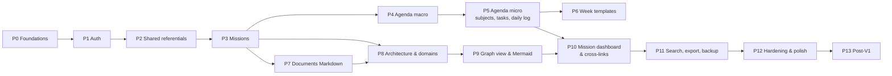

# Work Orchestrator — Roadmap

> Version 0.1 — 2026-11-05. Basée sur le [cadrage](00-CADRAGE.md) et les hypothèses par défaut des [questions](01-QUESTIONS.md).
>
> Principe : **chaque phase livre quelque chose d'utilisable**. Dès la fin de la phase 4, l'agenda sert au quotidien ; les phases suivantes l'enrichissent.
>
> **Règle permanente** : tout ticket qui prend une décision structurante (dépendance, entité, règle transverse, sécurité, déploiement) livre son ADR dans `docs/adr/` dans le même changement (ADR-0001). Un ticket qui contredit un ADR accepté est bloqué jusqu'à arbitrage.
>
> Notation : `[ ]` à faire, `[x]` fait. Chaque ticket a un identifiant `P<phase>-<n>`. Les tickets back-end incluent toujours migration Alembic + schémas + service + routes + **tests**. Les tickets front incluent les traductions EN/FR et les tests.

## Vue d'ensemble

| Phase | Titre | Questions bloquantes | Jalon |
|-------|-------|----------------------|-------|
| P0 | Fondations du dépôt | ✅ tranchées | `make init && make test && make deploy` fonctionnent sur un squelette |
| P1 | Authentification | Q-B1 | Connexion, déconnexion, gestion des comptes |
| P2 | Référentiels partagés | Q-C3 | Secteurs, entreprises, organisation, contacts, technologies |
| P3 | Missions | Q-C8 | CRUD missions + page mission minimale |
| P4 | Agenda macro | Q-E1 | **Jalon utilisable n° 1** : saisie des demi-journées, vues année et mois |
| P5 | Agenda micro | Q-G1, Q-G4, Q-G7 | **Jalon utilisable n° 2** : standup quotidien, sujets, tâches |
| P6 | Semaines types | — | Modèles appliqués sur une plage |
| P7 | Documents Markdown | Q-I1, Q-I2 | Éditeur, Mermaid, wikilinks, versions |
| P8 | Architecture et domaines | Q-H1, Q-H2 | Architectures, arbre et relations de domaines |
| P9 | Graphe et export Mermaid | — | **Jalon utilisable n° 3** : cartographie interactive exportable |
| P10 | Tableau de bord mission et liens croisés | — | Vue 360° d'une mission |
| P11 | Recherche, export, sauvegarde | — | Recherche globale, réversibilité |
| P12 | Durcissement et finitions | — | **V1** |
| P13 | Après V1 | — | Évolutions |

---

## P0 — Fondations du dépôt

Objectif : un squelette back + front + Docker + Makefile, testé, sans fonctionnalité métier.

### Dépôt et outillage
- [x] **P0-1** `git init`, `.gitignore` (Python, Node, `.env`, `backups/`), `.editorconfig`, `README.md`
- [x] **P0-2** `.env.example` documenté (DB, `SECRET_KEY`, ports, `DEFAULT_LOCALE`, `CORS_ORIGINS`)
- [x] **P0-3** `pre-commit` : ruff, ruff-format, mypy, eslint, prettier, détection de secrets
- [x] **P0-4** Dossier `docs/adr/` : index, modèle, instructions LLM, ADR 0001 à 0028
- [x] **P0-4b** Outillage ADR : `make adr-new t="Title"` (copie le modèle, numérote, ajoute la ligne d'index) et `make adr-check` (index cohérent avec les fichiers, aucun `<placeholder>` restant), branché sur `make lint`
- [x] **P0-5** `CLAUDE.md` (règle ADR, commandes, architecture)

### Back-end
- [x] **P0-6** `backend/pyproject.toml` (uv) : FastAPI, uvicorn, SQLAlchemy 2 async, asyncpg, Alembic, pydantic-settings, argon2-cffi, pyjwt ; groupe dev : pytest, pytest-asyncio, pytest-cov, httpx, factory-boy, ruff, mypy
- [x] **P0-7** Structure `app/core` (config, db session, logging structuré), `app/modules`, `app/shared`
- [x] **P0-8** Classe de base des modèles : UUID v7, `created_at`, `updated_at`, convention de nommage des contraintes (pour Alembic)
- [x] **P0-9** Format d'erreur unifié `{code, detail, params}` + gestionnaires d'exceptions
- [x] **P0-10** Route `GET /api/v1/health` (vérifie la base)
- [x] **P0-11** Alembic configuré en async, migration initiale vide
- [x] **P0-12** Infrastructure de test : base Postgres de test, fixture de session transactionnelle, client `httpx.AsyncClient`, factories
- [x] **P0-13** `backend/Dockerfile` multi-stage (uv, utilisateur non root, healthcheck)

### Front-end
- [x] **P0-14** Vite + React 19 + TypeScript strict, ESLint, Prettier
- [x] **P0-15** Mantine, React Router, TanStack Query, `react-i18next` (fichiers `en` / `fr`), sélecteur de langue
- [x] **P0-16** Layout applicatif : barre latérale (Agenda, Missions, Architecture, Documents, Annuaire, Paramètres), en-tête, thème clair/sombre
- [x] **P0-17** Génération du client API (`openapi-typescript` + `openapi-fetch`) + `make api-client`
- [x] **P0-18** Vitest + Testing Library + MSW ; Playwright installé avec un test de fumée
- [x] **P0-19** `frontend/Dockerfile` multi-stage (build node, service nginx) + `nginx.conf` (SPA fallback, proxy `/api`)

### Orchestration
- [x] **P0-20** `docker-compose.yml` (db, backend, frontend, volumes, healthchecks, réseau interne, Postgres non exposé)
- [x] **P0-21** `docker-compose.dev.yml` (surcouche explicite : base publiée en local) ; back et front lancés sur l'hôte avec rechargement à chaud (ADR-0029)
- [x] **P0-22** `Makefile` : `help`, `env`, `init`, `dev`, `deploy`, `down`, `logs`, `test`, `test-back`, `test-front`, `test-e2e`, `coverage`, `lint`, `format`, `typecheck`, `migrate`, `migration`, `api-client`, `clean`
- [x] **P0-22b** `BASE_PATH` de bout en bout (ADR-0011) : arg de build Vite, `basename` du routeur, `root_path` FastAPI, nginx du conteneur front, `--proxy-headers`, port publié sur `127.0.0.1` ; extrait de configuration nginx externe dans `docs/OPERATIONS.md`
- [x] **P0-23** (optionnel, Q-M5) CI GitHub Actions lançant lint + tests

**Définition de terminé** : sur une machine vierge (avec Docker, uv, Node), `make init && make test && make deploy` aboutit, la page d'accueil s'affiche en FR et EN, `/api/v1/health` répond, y compris sous `/work-orchestrator`.

---

## P1 — Authentification

- [x] **P1-1** Modèles `User` (email, password_hash, display_name, role, locale, theme, is_active) et `RefreshToken` (hash, expiration, révocation, user-agent)
- [x] **P1-2** Service de hachage Argon2id + rehash automatique si paramètres changés
- [x] **P1-2b** Politique de mot de passe (ADR-0008) : module unique côté back, checklist en direct côté front, codes d'erreur traduits
- [x] **P1-3** `POST /auth/login` : JWT d'accès + refresh token en cookies `httpOnly`, `Secure` configurable, `SameSite=Strict`
- [x] **P1-4** `POST /auth/refresh` avec rotation et détection de réutilisation (révocation de la famille)
- [x] **P1-5** `POST /auth/logout` (révocation), `GET /auth/me`
- [x] **P1-6** Limitation des tentatives (5 échecs → verrouillage 15 min), messages d'erreur neutres
- [x] **P1-7** Dépendance FastAPI `current_user` / `require_admin` ; toutes les routes protégées par défaut
- [x] **P1-8** Administration des comptes : CRUD utilisateurs, réinitialisation de mot de passe (admin)
- [x] **P1-9** `PATCH /me` (nom, langue, thème) et `POST /me/password`
- [x] **P1-10** Commandes CLI : `create-admin`, `reset-password` + cibles Make associées ; `make init` crée l'admin
- [x] **P1-11** Front : page de connexion, garde de routes, rafraîchissement silencieux du token, déconnexion
- [x] **P1-12** Front : page Profil (langue persistée côté serveur, thème, mot de passe), page d'administration des comptes
- [x] **P1-13** Tests : tous les cas d'erreur (mauvais mot de passe, compte inactif, token expiré, réutilisation de refresh), E2E connexion

**DoD** : impossible d'accéder à une donnée sans session ; la langue choisie suit l'utilisateur.

> Détails d'implémentation : ADR-0030 (protection par défaut, limitation par e-mail, rotation avec délai de grâce, cookies). Purge des jetons expirés reportée en P12.

---

## P2 — Référentiels partagés

### Secteurs et entreprises
- [x] **P2-1** `Sector` hiérarchique + données initiales (seed) FR/EN
- [x] **P2-2** `Company` : nom, type (CLIENT, ESN, OTHER — multivalué), secteur principal et secondaires, société mère, site web, notes Markdown, `archived_at`
- [x] **P2-3** Paramètre utilisateur « mon ESN » (`employer_company_id`), recopié par défaut sur chaque nouvelle mission
- [x] **P2-4** Front : liste filtrable et fiche entreprise (onglets : infos, organisation, contacts, missions)

### Organisation client
- [x] **P2-5** `OrgUnit` (arbre par entreprise, type libellé : direction, pôle, équipe…) ; contrôle d'acyclicité (RG-08)
- [x] **P2-6** API arbre (CTE récursive) : sous-arbre, ancêtres, déplacement d'un nœud
- [x] **P2-7** Front : éditeur d'arbre (ajout, renommage, déplacement par choix du parent ; glisser-déposer reporté, ADR-0031)

### Contacts
- [x] **P2-8** `Contact` (+ `ContactEmployment` pour l'historique, rattachement optionnel à une `OrgUnit`)
- [x] **P2-9** Détection de doublons à la création (nom + e-mail approchants)
- [x] **P2-10** Front : annuaire global (recherche, filtres entreprise / mission / unité), fiche contact

### Technologies et tags
- [x] **P2-11** `Technology` (nom, catégorie, alias, description) + seed d'environ 150 technologies
- [x] **P2-12** `Tag` + table d'association polymorphe (`taggings` : entity_type, entity_id)
- [x] **P2-13** Front : catalogue de technologies, gestion des tags, composant `TagInput` réutilisable

### Transverse
- [x] **P2-14** Composants front génériques : `EntityTable` (pagination serveur), `TreeList`, sélecteurs (`CompanySelect`, `SectorSelect`, `OrgUnitSelect`, `TagInput`), `MarkdownView`, `ConfirmDialog`
- [x] **P2-15** `make seed` : premier jeu de données de démonstration (entreprises, contacts, technologies)

**DoD** : un client avec son organisation et ses contacts peut être saisi entièrement depuis l'interface.

> Choix d'implémentation : ADR-0031 (tags polymorphes, unicité par nom normalisé, archivage, données de référence idempotentes).

---

## P3 — Missions

- [x] **P3-1** `Mission` (cf. cadrage §5.3) + `MissionEndDateChange` (historique des renouvellements)
- [x] **P3-2** `MissionContact` (rôle depuis une liste modifiable `ContactRole`)
- [x] **P3-3** `MissionTechnology` (pondération 1–5, version optionnelle, note)
- [x] **P3-4** Règles : dates cohérentes, archivage au lieu de suppression si référencée (RG-12), statut dérivé suggéré selon les dates
- [x] **P3-5** API : CRUD, filtres (statut, client, période), « missions actives à une date »
- [x] **P3-6** Front : liste des missions (cartes ou tableau), formulaire de création en étapes (client, ESN pré-remplie, poste, dates)
- [x] **P3-7** Front : page mission v0 (en-tête, onglets Contacts, Technologies, Notes) — sera enrichie en P10
- [x] **P3-8** Couleur de mission (palette accessible, choix automatique distinct)
- [x] **P3-9** Seed : 3 missions sur 2 clients

**DoD** : une mission complète (contacts avec rôles, technologies pondérées) est consultable depuis sa page.

> Choix d'implémentation : ADR-0032 (propriété des données, statut suggéré, historique de fin, suppression bloquée par les références). Onglet « Missions » ajouté à la fiche entreprise ; rôles de contact gérés dans l'Annuaire.

---

## P4 — Agenda macro (jalon utilisable n° 1)

### Back-end
- [x] **P4-1** `HalfDay` + énumération `HalfDayKind` + `HalfDaySubtype` modifiables (CP, RTT…)
- [x] **P4-2** Règles RG-01, RG-02 (mission obligatoire et dans sa période)
- [x] **P4-3** API par plage : `GET /agenda/half-days?from=&to=` (optimisée pour une année), `PUT` unitaire, **`POST /agenda/half-days/bulk`** (affecter une nature ou une mission à une sélection), `DELETE` en masse
- [x] **P4-4** Jours fériés : bibliothèque `holidays`, région paramétrable, génération idempotente pour une année (RG-11)
- [x] **P4-5** Statistiques par période : nombre de jours par nature, par mission, jours non saisis
- [x] **P4-6** Tests : bornes de dates, conflits, opérations en masse transactionnelles, années bissextiles

### Front-end
- [x] **P4-7** Composant `HalfDayCell` (moitié haute matin, moitié basse après-midi, couleur + motif pour l'accessibilité)
- [x] **P4-8** **Vue Année** : 12 mois, totaux, légende, clic sur un mois → vue Mois
- [x] **P4-9** **Vue Mois** : sélection par clic, maj+clic, glisser ; panneau d'affectation (nature, mission, lieu)
- [x] **P4-10** Navigation macro ↔ micro (année → mois → semaine → jour) avec URL partageables (`/agenda/2026/11`)
- [x] **P4-11** Indicateur « demi-journées passées non saisies » (Q-E8)
- [x] **P4-12** Depuis une demi-journée MISSION : lien vers la page mission
- [x] **P4-13** E2E : poser une semaine de congés, affecter 2 semaines à une mission

### Validation mensuelle (ADR-0021)
- [x] **P4-14** `MonthLock` + `MonthLockEvent`, garde unique `ensure_month_unlocked` sur toutes les écritures d'agenda (demi-journées, tâches, opérations en masse, jours fériés, semaines types)
- [x] **P4-15** Validation : contrôle de complétude des jours ouvrés (`MONTH_INCOMPLETE`), récapitulatif par nature et par mission ; déverrouillage avec motif obligatoire
- [x] **P4-16** Front : badge de verrou sur les vues Mois et Année, assistant « Valider le mois », historique des verrouillages

**DoD** : on peut saisir et consulter une année complète en moins de 5 minutes.

> Choix d'implémentation : ADR-0033 (API par créneaux, jours fériés pré-remplis une fois par an selon la région du profil, complétude = jours ouvrés hors fériés, refus de déplacer une mission qui laisserait des demi-journées hors période). Types de journée gérés dans l'Annuaire.

---

## P5 — Agenda micro : sujets, tâches, journal (jalon utilisable n° 2)

### Sujets
- [ ] **P5-1** `Subject` (arbre, `scope`, `mission_id`, statut, URL externe, catégorie) ; héritage de portée (RG-07), acyclicité (RG-08)
- [ ] **P5-2** API : arbre par mission ou par portée, déplacement, archivage
- [ ] **P5-3** Front : panneau « Sujets » de la mission (arbre repliable, création rapide de sous-sujets)

### Tâches
- [ ] **P5-4** `Task` (half_day, subject, kind TASK ou MEETING, heure de début optionnelle, durée, statut, description Markdown, ref externe) + `TaskParticipant` (contacts) pour les réunions
- [ ] **P5-5** Règles de compatibilité **RG-03, RG-04, RG-05** (matrice nature de demi-journée × portée du sujet), testées exhaustivement en paramétré
- [ ] **P5-6** Avertissement de dépassement de durée (RG-06), renvoyé dans la réponse API
- [ ] **P5-7** Action « reporter » : copie la tâche vers la prochaine demi-journée compatible, statut CARRIED_OVER sur l'original

### Journal quotidien
- [ ] **P5-8** `DailyLog` (date, sections fait / prévu / blocages en Markdown)
- [ ] **P5-9** Génération du texte de standup à partir des tâches (hier : faites ; aujourd'hui : prévues), copiable

### Front-end
- [ ] **P5-10** **Vue Semaine** : colonnes jours × demi-journées, tâches en cartes, glisser-déposer entre demi-journées (avec validation des règles côté client et serveur)
- [ ] **P5-11** **Vue Jour** : journal, tâches, durées cumulées, liens vers sujets et mission
- [ ] **P5-12** **Écran Standup** (page d'accueil du matin) : tâches d'hier à cocher (faite, reportée, annulée), planification d'aujourd'hui, bouton « copier mon standup »
- [ ] **P5-13** Saisie rapide de tâche (`n`) avec autocomplétion du sujet
- [ ] **P5-14** E2E : parcours complet d'un matin (standup → planification)

**DoD** : la saisie quotidienne prend moins de 2 minutes ; impossible de placer une tâche d'inter-contrat dans une demi-journée mission.

---

## P6 — Semaines types

- [ ] **P6-1** `WeekTemplate` (nom, description, mission par défaut) + `WeekTemplateSlot` (jour de semaine, période, nature, sous-type, mission, lieu)
- [ ] **P6-2** API : CRUD, duplication
- [ ] **P6-3** **Prévisualisation** de l'application sur une plage : créations, conflits (déjà saisi), jours fériés ignorés
- [ ] **P6-4** Application avec stratégie de conflit : `skip` (défaut, RG-10) ou `overwrite` (confirmation)
- [ ] **P6-5** Option : semaine type par défaut associée à une mission, proposée lors de la saisie
- [ ] **P6-6** Front : éditeur visuel de semaine type (grille 7 × 2), liste des modèles
- [ ] **P6-7** Front : assistant d'application (choix du modèle, plage, prévisualisation colorée des changements, confirmation)
- [ ] **P6-8** Tests : application sur des plages chevauchant des jours fériés, des congés, des fins de mission

**DoD** : un mois de mission en « 3 j sur site, 2 j télétravail » se remplit en 3 clics.

---

## P7 — Documents Markdown

- [ ] **P7-1** `Document` (titre, slug, contenu Markdown, parent pour l'arbre, `owner_id`, archivé) + `DocumentVersion`
- [ ] **P7-2** `DocumentAttachment` : rattachement d'un document à des entités (mission, architecture, domaine, sujet, entreprise)
- [ ] **P7-3** Parser de wikilinks côté back (`[[type:id|libellé]]`), extraction à chaque sauvegarde → `DocumentLink` (rétroliens)
- [ ] **P7-4** API : CRUD, arbre, versions (liste, lecture, restauration), rétroliens d'une entité quelconque
- [ ] **P7-5** Stockage de fichiers (volume Docker) : upload d'images et pièces jointes, taille limitée, types autorisés, servis par le back avec contrôle d'accès
- [ ] **P7-6** `DocumentTemplate` + modèles initiaux (fiche domaine, compte rendu de réunion, onboarding mission, rapport d'étonnement, ADR)
- [ ] **P7-7** Front : éditeur CodeMirror 6 (coloration Markdown, raccourcis), aperçu côte à côte, sauvegarde automatique en brouillon
- [ ] **P7-8** Front : rendu `react-markdown` + GFM + **blocs Mermaid rendus**, coloration syntaxique du code
- [ ] **P7-9** Front : autocomplétion `[[` sur toutes les entités, liens cliquables dans l'aperçu
- [ ] **P7-10** Front : collage d'image depuis le presse-papiers → upload → insertion du lien
- [ ] **P7-11** **Export** : « Copier en Markdown » (wikilinks convertis en texte ou en liens absolus), téléchargement `.md`, option Mermaid → SVG (Q-I3)
- [ ] **P7-12** Front : arbre des documents, panneau de rétroliens, historique des versions
- [ ] **P7-13** Tests : extraction des wikilinks (cas limites), versions, contrôle d'accès aux fichiers

**DoD** : une page de doc avec diagramme Mermaid et liens internes se copie proprement dans un outil externe.

---

## P8 — Architecture et domaines

- [ ] **P8-1** `Architecture` (nom, description Markdown, entreprise, lifecycle) + `MissionArchitecture` (plusieurs-à-plusieurs, Q-H1)
- [ ] **P8-2** `Domain` (entreprise, parent, nom, kind, description, criticité, lifecycle CURRENT/TARGET/DEPRECATED, responsable `OrgUnit`, contact référent) + `ArchitectureDomain`
- [ ] **P8-3** `DomainRelation` (source, cible, type, libellé, protocole, sync/async, lifecycle) ; RG-09
- [ ] **P8-4** `DomainTechnology` (version optionnelle) ; `SubjectDomain` (lien sujet ↔ domaine, Q-G5)
- [ ] **P8-5** `ExternalLink` polymorphe (dépôt Git, Jira, environnement…) sur domaine, mission, sujet
- [ ] **P8-6** Contraintes : domaines d'un même client dans une architecture (Q-H2), acyclicité de l'arbre (RG-08)
- [ ] **P8-7** API graphe : `GET /architectures/{id}/graph?depth=&include_relations=&kinds=` → nœuds et arêtes (CTE récursive) ; ancêtres et descendants d'un domaine
- [ ] **P8-8** Front : liste des architectures d'une mission, page architecture (description, arbre des domaines)
- [ ] **P8-9** Front : fiche domaine (description Markdown, sous-domaines, relations entrantes et sortantes, technologies, responsable avec remontée direction > pôle > équipe, sujets et tâches liés, documents)
- [ ] **P8-10** Front : formulaires de relation avec sélection des domaines
- [ ] **P8-11** Seed : architecture de démonstration (≈ 25 domaines sur 3 niveaux, 30 relations)
- [ ] **P8-12** Tests : arbres profonds (≥ 10 niveaux), déplacement de sous-arbre, cycles refusés, performances du graphe

**DoD** : une architecture réaliste se saisit et se parcourt via les fiches.

---

## P9 — Vue graphe et export Mermaid (jalon utilisable n° 3)

### Export Mermaid (back, testé unitairement)
- [ ] **P9-1** Générateur `flowchart` : domaines → nœuds (forme selon `kind`), sous-domaines → `subgraph` imbriqués, relations → arêtes libellées (pointillés pour l'asynchrone), échappement des caractères spéciaux, identifiants stables
- [ ] **P9-2** Options : profondeur, filtre par type, direction (`LR`/`TB`), inclusion de l'état cible
- [ ] **P9-3** Générateur `mindmap` de l'arbre des domaines
- [ ] **P9-4** Tests par instantanés (snapshot) des sorties Mermaid + validation syntaxique (rendu `mermaid` en test front)

### Graphe interactif (front)
- [ ] **P9-5** React Flow + disposition automatique ELK (hiérarchique, groupes pour les sous-domaines)
- [ ] **P9-6** Nœuds personnalisés (icône par type, responsable, badge criticité), arêtes typées avec légende
- [ ] **P9-7** Repli et dépli des sous-domaines, filtres (type, équipe, lifecycle, profondeur), recherche d'un nœud, mise en évidence des voisins
- [ ] **P9-8** Création de relation par glisser entre deux nœuds, création de domaine depuis le graphe
- [ ] **P9-9** Mémorisation des positions manuelles (`DomainLayout` par architecture)
- [ ] **P9-10** Bascule vue « actuel » / « cible » / « les deux » (différences surlignées)
- [ ] **P9-11** Panneau d'export : aperçu Mermaid rendu, copier le code, télécharger `.mmd` / `.svg` / `.png`
- [ ] **P9-12** Vue graphe de la **connaissance** : documents et entités reliés par wikilinks (façon Obsidian)
- [ ] **P9-13** E2E : créer deux domaines, les relier dans le graphe, exporter le Mermaid

**DoD** : le Mermaid exporté d'une architecture de 50 domaines s'affiche correctement dans GitHub.

---

## P10 — Tableau de bord mission et liens croisés

- [ ] **P10-1** API agrégée `GET /missions/{id}/overview` : temps passé (jours, demi-journées, répartition par sujet), tâches récentes et prévues, technologies pondérées, contacts, architectures, documents, jours restants
- [ ] **P10-2** Suggestion de pondération des technologies (technologies des domaines × temps des sujets liés) (Q-J2)
- [ ] **P10-3** Front : page mission complète — en-tête, KPI, graphique de répartition du temps, technologies pondérées, contacts par rôle, mini-graphe de l'architecture, documents
- [ ] **P10-4** Page d'accueil : standup du jour, mission active, jours non saisis, derniers documents modifiés
- [ ] **P10-5** Vue **carrière** : frise des missions (dates, client, technologies principales)
- [ ] **P10-6** Liens croisés systématiques : agenda → mission → architecture → domaine → sujets → tâches dans l'agenda (filtre de l'agenda par sujet ou par domaine)
- [ ] **P10-7** Panneau « Rétroliens » générique sur toutes les fiches
- [ ] **P10-8** Tests de cohérence des agrégats (temps passé recalculé sur jeu de données connu)

**DoD** : depuis n'importe quelle journée de l'agenda, on atteint la doc d'architecture concernée en ≤ 2 clics, et inversement.

---

## P11 — Recherche, export, sauvegarde

- [ ] **P11-1** Recherche plein texte Postgres (`tsvector` FR + EN, index GIN) sur documents, journaux, tâches, sujets, domaines, contacts, missions, entreprises
- [ ] **P11-2** API `GET /search?q=&types=` avec extraits surlignés et classement
- [ ] **P11-3** Front : palette `Ctrl+K` (Mantine Spotlight) : recherche + actions rapides (nouvelle tâche, aller à aujourd'hui)
- [ ] **P11-4** Export complet : archive zip (JSON de toutes les entités + documents en `.md` + pièces jointes)
- [ ] **P11-5** Import de cette archive (restauration sur instance vierge), tests aller-retour
- [ ] **P11-6** Import d'un dossier Markdown (Obsidian) → documents (Q-I8)
- [ ] **P11-7** Export et import CSV des contacts (Q-D5)
- [ ] **P11-8** `make backup` / `make restore` (pg_dump + volume des fichiers), rétention configurable ; conteneur de sauvegarde quotidienne optionnel (Q-M7)
- [ ] **P11-9** Documentation de restauration testée (`docs/OPERATIONS.md`)

**DoD** : une restauration complète sur une machine neuve fonctionne en suivant la doc.

---

## P12 — Durcissement et finitions (V1)

- [ ] **P12-1** Revue de sécurité : en-têtes (CSP, X-Frame-Options), CORS, contrôle d'accès par `owner_id` testé sur chaque route (tests automatiques « un utilisateur ne voit pas les données d'un autre »)
- [ ] **P12-2** Performances : profilage des vues année et graphe, index manquants, pagination partout
- [ ] **P12-3** Accessibilité : navigation clavier, lecteurs d'écran sur l'agenda, contrastes (audit axe en E2E)
- [ ] **P12-4** Traductions complètes FR/EN vérifiées (test qui échoue si une clé manque dans une langue)
- [ ] **P12-5** États vides, chargements, erreurs : messages traduits et actions proposées
- [ ] **P12-6** Seuils de couverture atteints et bloquants dans `make test`
- [ ] **P12-7** Test de migration complet `upgrade` / `downgrade` / `upgrade`
- [ ] **P12-8** Documentation utilisateur (guide de démarrage, raccourcis), `README` à jour
- [ ] **P12-9** Tag `v1.0.0`, changelog

**DoD** : V1 utilisée au quotidien pendant 2 semaines sans bug bloquant.

---

## P13 — Après V1 (à prioriser selon les réponses)

| Ticket | Évolution | Lié à |
|--------|-----------|-------|
| P13-1 | Export **CRA** mensuel (PDF, CSV, format ESN) à partir des mois validés | Q-L1, ADR-0021 |
| P13-2 | Export ICS de l'agenda | Q-L2 |
| P13-3 | Tâches récurrentes (daily, rituels) dans les semaines types | Q-F1 |
| P13-4 | **ADR** (décisions d'architecture) liées aux domaines | O |
| P13-5 | **Glossaire** du client (acronymes), infobulles automatiques dans les documents | O |
| P13-6 | Compétences, certifications, réalisations → génération de **CV** et de bilan de mission | Q-J5, O |
| P13-7 | Statistiques : temps par technologie sur la carrière, taux d'inter-contrat, tendances | — |
| P13-8 | Import de diagrammes Mermaid vers domaines et relations | Q-H12 |
| P13-9 | Export C4 (`C4Context`, `C4Container`) | Q-H10 |
| P13-10 | Diff visuel entre versions de documents | Q-I6 |
| P13-11 | Historisation de l'architecture (vue à une date) | Q-H8 |
| P13-12 | Assistant IA (résumé hebdo, génération du standup, questions sur la doc) — local ou API | Q-L4 |
| P13-13 | Éditeur WYSIWYG façon Notion | Q-I2 |
| P13-14 | PWA mobile pour la saisie quotidienne | Q-A5 |
| P13-15 | Rappels (fin de mission proche, jours non saisis) | O |

---

## Suivi

| Phase | Statut | Démarrée | Terminée |
|-------|--------|----------|----------|
| Cadrage | Terminé | 2026-11-05 | 2026-11-05 |
| P0 | Terminée | 2026-11-05 | 2026-11-05 |
| P1 | Terminée | 2026-11-05 | 2026-11-05 |
| P2 | Terminée | 2026-11-05 | 2026-11-05 |
| P3 | Terminée | 2026-11-05 | 2026-11-05 |
| P4 | Terminée | 2026-11-05 | 2026-11-05 |
| P5 | À faire | | |
| P6 | À faire | | |
| P7 | À faire | | |
| P8 | À faire | | |
| P9 | À faire | | |
| P10 | À faire | | |
| P11 | À faire | | |
| P12 | À faire | | |
