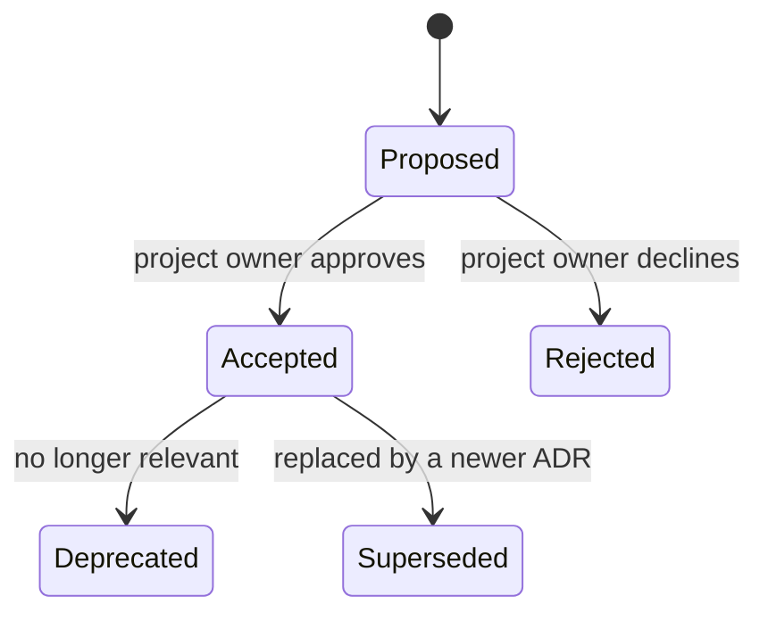

# Architecture Decision Records

This folder records every structuring decision taken on Work Orchestrator: technical choices, data-model choices, business rules with architectural impact, and conventions.

An ADR answers one question: **why is it like this?** Code shows *what*; ADRs keep the *why* and the alternatives that were rejected.

- Template: [0000-template.md](0000-template.md)
- Instructions for LLM agents: [LLM-INSTRUCTIONS.md](LLM-INSTRUCTIONS.md)

## When to write an ADR

Write one when a decision:

- picks a technology, library, protocol or pattern (and rejects others);
- shapes the data model (new entity, cardinality, ownership, deletion strategy);
- encodes a business rule that constrains several modules;
- changes deployment, security, or the development workflow;
- would make a future developer ask "why on earth did they do that?".

Do **not** write one for: naming of a local variable, a bug fix, a UI tweak, a decision fully reversible in under an hour.

## Lifecycle

- An **Accepted** ADR is immutable in substance. To change a decision, write a new ADR that supersedes it, and update the old one's status line only (`Superseded by ADR-00XX`).
- Typos, broken links and added "Notes" are allowed edits.
- Rejected ADRs are kept: they document what was considered.

## Conventions

- File name: `NNNN-kebab-case-title.md`, four digits, sequential, never reused.
- Language: English (project convention, see ADR-0013).
- Each ADR names its **Source**: the question (`Q-xx`), ticket (`P4-3`), or conversation that produced it.
- Commits implementing an ADR reference it: `feat(agenda): add month lock (ADR-0021)`.
- Code that looks surprising because of an ADR carries a short comment: `# See ADR-0020: task/half-day compatibility matrix`.

## Index

| ADR | Title | Status | Date | Tags |
|-----|-------|--------|------|------|
| [0001](0001-record-architecture-decisions.md) | Record architecture decisions | Accepted | 2026-11-05 | process |
| [0002](0002-modular-monolith-spa.md) | Modular monolith backend + SPA frontend | Accepted | 2026-11-05 | architecture |
| [0003](0003-postgresql-single-datastore.md) | PostgreSQL as the single datastore | Accepted | 2026-11-05 | data |
| [0004](0004-backend-stack.md) | Backend stack: FastAPI, SQLAlchemy 2 async, Alembic, uv | Accepted | 2026-11-05 | backend |
| [0005](0005-frontend-stack.md) | Frontend stack: React, TypeScript, Vite, TanStack Query | Accepted | 2026-11-05 | frontend |
| [0006](0006-mantine-ui-library.md) | Mantine as UI component library | Accepted | 2026-11-05 | frontend |
| [0007](0007-home-made-authentication.md) | Home-made authentication with JWT and rotating refresh tokens | Accepted | 2026-11-05 | security |
| [0008](0008-password-policy.md) | Password policy | Accepted | 2026-11-05 | security |
| [0009](0009-account-provisioning.md) | Admin-only account provisioning | Accepted | 2026-11-05 | security |
| [0010](0010-multi-user-model-single-user-usage.md) | Multi-user data model, single-user usage | Accepted | 2026-11-05 | data |
| [0011](0011-reverse-proxy-sub-path.md) | Served behind a reverse proxy under a sub-path | Accepted | 2026-11-05 | deployment |
| [0012](0012-docker-compose-makefile.md) | Docker Compose deployment, Makefile as entry point | Accepted | 2026-11-05 | deployment |
| [0013](0013-i18n-and-english-codebase.md) | EN/FR interface, English codebase | Accepted | 2026-11-05 | conventions |
| [0014](0014-api-conventions.md) | REST API conventions | Accepted | 2026-11-05 | backend |
| [0015](0015-generated-api-client.md) | Typed API client generated from OpenAPI | Accepted | 2026-11-05 | frontend |
| [0016](0016-testing-strategy.md) | Testing strategy and blocking coverage thresholds | Accepted | 2026-11-05 | quality |
| [0017](0017-mission-client-and-employer.md) | Mission = client + employer company | Accepted | 2026-11-05 | domain |
| [0018](0018-half-day-agenda-unit.md) | Half-day as the agenda's atomic unit | Accepted | 2026-11-05 | domain |
| [0019](0019-work-location.md) | Work location per half-day | Accepted | 2026-11-05 | domain |
| [0020](0020-task-half-day-compatibility.md) | Task / half-day compatibility matrix | Accepted | 2026-11-05 | domain |
| [0021](0021-monthly-lock.md) | Monthly lock (timesheet-like) | Accepted | 2026-11-05 | domain |
| [0022](0022-trees-and-typed-relations.md) | Trees with a single parent + typed relations for graphs | Accepted | 2026-11-05 | data |
| [0023](0023-domain-and-architecture-ownership.md) | Domains belong to a client; architectures ↔ missions many-to-many | Accepted | 2026-11-05 | domain |
| [0024](0024-markdown-documentation.md) | Markdown as source of truth, wikilinks and backlinks | Accepted | 2026-11-05 | documents |
| [0025](0025-graph-rendering-and-mermaid-export.md) | React Flow + ELK for graphs, server-side Mermaid export | Accepted | 2026-11-05 | architecture-app |
| [0026](0026-postgres-full-text-search.md) | Full-text search with PostgreSQL | Accepted | 2026-11-05 | search |
| [0027](0027-local-file-storage.md) | Attachments stored on a local volume | Accepted | 2026-11-05 | data |
| [0028](0028-no-external-calls-at-runtime.md) | No external network calls at runtime | Accepted | 2026-11-05 | security |
| [0029](0029-development-environment.md) | Development environment: host processes, dockerized database | Accepted | 2026-11-05 | deployment, process |
| [0030](0030-authentication-implementation.md) | Authentication implementation details | Accepted | 2026-11-05 | security, backend, frontend |
| [0031](0031-shared-referentials.md) | Shared referentials: model, tags, deletion and reference data | Accepted | 2026-11-05 | data, domain |
| [0032](0032-missions-implementation.md) | Missions: ownership enforcement, status, history and links | Accepted | 2026-11-05 | domain, data |
| [0033](0033-agenda-macro-implementation.md) | Agenda macro: slot API, public holidays, completeness and rendering | Accepted | 2026-11-05 | domain, backend, frontend |

Next free number: **0034**.
